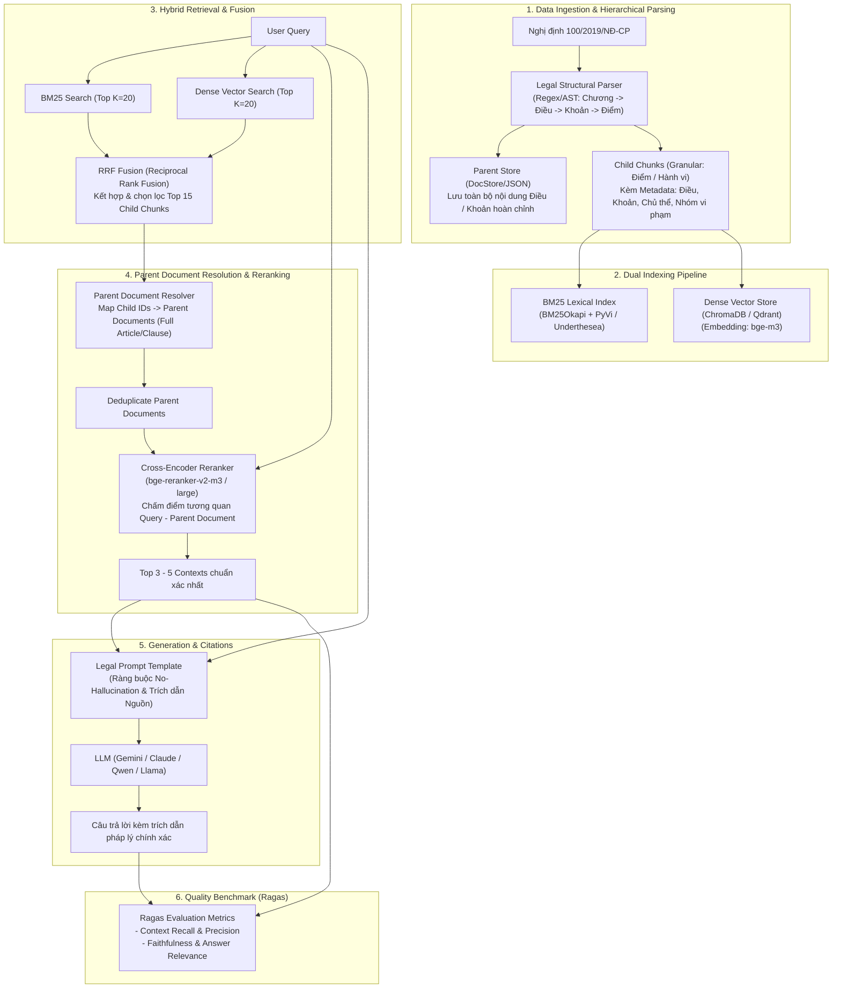

# KẾ HOẠCH DỰ ÁN: ADVANCED RAG TRA CỨU LUẬT GIAO THÔNG VIỆT NAM (NGHỊ ĐỊNH 100/2019/NĐ-CP)

> **Mục tiêu chính:** Khắc phục triệt để hai hạn chế cốt lõi của Traditional RAG trong bài toán văn bản pháp lý:
> 1. **Exact Match Failure:** Thất bại trong việc truy vấn chính xác các thực thể số, điều khoản luật, tên biển báo, chỉ số nồng độ cồn, khung mức phạt tiền cụ thể.
> 2. **Chunk Severing:** Đứt gãy ngữ cảnh logic khi cắt nhỏ tài liệu tùy tiện, làm mất mối quan hệ phân cấp giữa **Chương -> Mục -> Điều -> Khoản -> Điểm** (ví dụ: hành vi vi phạm ở Điểm a nhưng đối tượng áp dụng là ô tô hay xe máy lại nằm ở tên Khoản/Điều).

---

## 1. Kiến trúc Hệ thống Tổng thể (System Architecture)



---

## 2. Giải pháp Kỹ thuật Cốt lõi (Core Technical Solutions)

### 2.1. Parent Document Retriever (Giải quyết Chunk Severing)
* **Vấn đề của Naive Chunking:** Cắt theo số lượng ký tự (`chunk_size=500`, `overlap=50`) khiến nội dung bị đứt đôi giữa chừng. Một đoạn trích Điểm a Khoản 3 nếu đứng riêng sẽ không biết chủ thể vi phạm là ai (người điều khiển xe máy, ô tô hay máy kéo).
* **Giải pháp Phân cấp (Hierarchical Chunking):**
  * **Parent Chunks:** Cấp độ **Điều** (Article) hoặc **Khoản** (Clause). Giữ toàn bộ bối cảnh: Chủ thể vi phạm, hình thức xử phạt chính, hình phạt bổ sung (tước bằng lái, tịch thu phương tiện), và biện pháp khắc phục hậu quả.
  * **Child Chunks:** Cấp độ **Điểm** (Point) hoặc từng hành vi vi phạm độc lập (~100–200 tokens). Mỗi child chunk được gắn metadata:
    ```json
    {
      "parent_id": "dieu_5_khoan_3",
      "dieu": "5",
      "khoan": "3",
      "diem": "a",
      "chu_the": "người điều khiển xe ô tô",
      "nhom_hanh_vi": "tốc độ / nồng độ cồn / làn đường"
    }
    ```
  * **Quy trình truy xuất:** Truy vấn tìm kiếm match vào **Child Chunk** (độ nhạy cao, embedding không bị loãng), nhưng nội dung trả về cho LLM làm context là **Parent Chunk** tương ứng.

### 2.2. Hybrid Search: BM25 + Dense RRF (Giải quyết Exact Match Failure)
* **Vấn đề của Dense-only:** Vector embeddings thường không nhớ chính xác con số cụ thể, tên biển báo (P.102, W.205), số hiệu điều khoản ("Điều 6 Khoản 4 Điểm c").
* **Kết hợp:**
  * **BM25 Lexical Search:** Sử dụng `rank_bm25` (BM25Okapi) trên văn bản tiếng Việt đã được tách từ (word segmentation bằng `pyvi` hoặc `underthesea`).
  * **Dense Vector Search:** Sử dụng mô hình embedding đa ngữ mạnh mẽ `BAAI/bge-m3` trên vector store (ChromaDB / Qdrant).
  * **Reciprocal Rank Fusion (RRF):** Kết hợp thứ hạng không phụ thuộc vào scale điểm số khác nhau của 2 phương pháp:
    $$RRF(d) = \sum_{m \in \{\text{BM25}, \text{Dense}\}} \frac{1}{k + r_m(d)} \quad (với\ k = 60)$$
  * Lấy Top 20 từ mỗi nhánh -> RRF chọn Top 15 child chunks ứng viên.

### 2.3. Cross-Encoder Reranker
* Sau khi map từ Child Chunks sang Parent Documents và loại bỏ trùng lặp, số lượng Parent Chunks thường là 5–8 văn bản.
* Dùng **Cross-Encoder Model** (ví dụ: `BAAI/bge-reranker-v2-m3` hoặc `BAAI/bge-reranker-large`):
  * Đánh giá trực tiếp mối tương quan giữa cặp `(Query, Parent Document)` thông qua attention cross-tokens toàn diện.
  * Lọc sạch tài liệu nhiễu (noise filtering) và chỉ chọn ra **Top 3 – Top 5** Parent Documents thực sự liên quan nhất chuyển cho LLM.

### 2.4. Đánh giá chất lượng với Ragas
* Xây dựng bộ dữ liệu đánh giá chuẩn (Golden Evaluation Dataset) gồm 30–50 câu hỏi kèm Ground Truth, chia làm 3 nhóm:
  1. *Câu hỏi Exact Match:* Tra cứu số hiệu điều luật, mã biển báo, mức phạt cụ thể.
  2. *Câu hỏi Tình huống:* Mô tả tình huống thực tế đời sống để suy luận điều luật tương ứng.
  3. *Câu hỏi Đa điều kiện:* Vi phạm nhiều lỗi cùng lúc, kết hợp phạt bổ sung.
* **4 chỉ số Ragas đo lường:**
  * **Context Recall:** Khả năng truy xuất đầy đủ toàn bộ căn cứ luật cần thiết.
  * **Context Precision:** Tỷ lệ tài liệu được truy xuất thực sự liên quan (độ sạch sau Reranking).
  * **Faithfulness:** Mức độ trung thực của câu trả lời, đảm bảo không bịa đặt số tiền hay điều luật.
  * **Answer Relevance:** Câu trả lời đi thẳng vào trọng tâm câu hỏi của người dùng.
* Thực hiện **A/B Testing đối chuẩn:** So sánh trực quan các chỉ số giữa **Naive Baseline RAG** và **Advanced RAG**.

---

## 3. Cấu trúc Thư mục Dự án Đề xuất

```text
advanced_rag/
│
├── data/
│   ├── raw/                      # Văn bản gốc Nghị định 100/2019/NĐ-CP (.docx/.txt/.pdf)
│   ├── processed/                # Dữ liệu JSON bóc tách (Articles, Clauses, Points)
│   └── evaluation/               # Golden Testset (questions, ground_truths, contexts)
│
├── src/
│   ├── __init__.py
│   ├── config.py                 # Cấu hình đường dẫn, model, hyperparameters (K, RRF k=60)
│   │
│   ├── ingestion/                # Giai đoạn 1: Tiền xử lý & Bóc tách cấu trúc
│   │   ├── __init__.py
│   │   ├── legal_parser.py       # Custom Regex Parser (Chương -> Điều -> Khoản -> Điểm)
│   │   └── text_splitter.py      # Tạo Parent Chunks & Child Chunks kèm metadata
│   │
│   ├── retrieval/                # Giai đoạn 2, 3, 4: Truy xuất & Tái xếp hạng
│   │   ├── __init__.py
│   │   ├── dense_retriever.py    # ChromaDB Vector Store & Embedding (BGE-M3)
│   │   ├── bm25_retriever.py     # BM25Okapi + Vietnamese Word Segmentation (PyVi)
│   │   ├── hybrid_rrf.py         # Reciprocal Rank Fusion kết hợp BM25 + Dense
│   │   ├── parent_resolver.py    # Map Child Chunk IDs -> Parent Document hoàn chỉnh
│   │   └── reranker.py           # Cross-Encoder Reranker (BGE-Reranker-M3)
│   │
│   ├── generation/               # Giai đoạn 5: Sinh câu trả lời
│   │   ├── __init__.py
│   │   ├── prompts.py            # Prompt Template chuyên ngành pháp lý & Citation rules
│   │   └── generator.py          # LLM Generation Chain
│   │
│   ├── evaluation/               # Giai đoạn 6: Đánh giá Ragas
│   │   ├── __init__.py
│   │   ├── evaluate_ragas.py     # Runner tính toán 4 metrics Ragas
│   │   └── compare_baselines.py  # So sánh Naive RAG vs Advanced RAG
│   │
│   └── pipeline.py               # End-to-end Pipeline tích hợp toàn bộ hệ thống
│
├── app/                          # Giai đoạn 7: UI Demo
│   └── app.py                    # Giao diện Streamlit / Gradio
│
├── notebooks/                    # Jupyter notebooks phân tích & thử nghiệm
│   ├── 01_legal_data_parsing.ipynb
│   └── 02_retrieval_benchmarking.ipynb
│
├── tests/                        # Unit tests
│   ├── test_parser.py
│   └── test_retrieval.py
│
├── requirements.txt              # Danh sách thư viện phụ thuộc
├── PROJECT_PLAN.md               # Bản kế hoạch chi tiết này
└── README.md                     # Tài liệu hướng dẫn sử dụng & kết quả thực nghiệm
```

---

## 4. Công nghệ & Thư viện Sử dụng (Tech Stack)

| Hạng mục | Công nghệ / Thư viện | Vai trò |
| :--- | :--- | :--- |
| **Language** | Python 3.10+ | Ngôn ngữ nền tảng |
| **Framework RAG** | `LangChain` / `LlamaIndex` | Quản lý Parent-Child Retriever, Documents Store và Chains |
| **Embedding Model** | `BAAI/bge-m3` | Embedding đa ngữ cực mạnh (Dense + Sparse), ngữ cảnh 8192 tokens |
| **Vector Database** | `ChromaDB` (hoặc `Qdrant`) | Lưu trữ và tìm kiếm vector nhúng của Child Chunks |
| **Lexical Search** | `rank-bm25` | Thuật toán BM25Okapi cho tìm kiếm từ khóa chính xác |
| **Vietnamese NLP** | `pyvi` / `underthesea` | Tách từ (Word Segmentation) hỗ trợ BM25 hiểu tiếng Việt |
| **Reranker Model** | `BAAI/bge-reranker-v2-m3` | Cross-Encoder xếp hạng lại Parent Documents |
| **LLM Generation** | Gemini API / OpenAI / Qwen | Sinh câu trả lời căn cứ vào luật |
| **Evaluation** | `ragas` + `datasets` | Đánh giá Context Precision/Recall, Faithfulness, Relevance |
| **Giao diện Demo** | `streamlit` | Giao diện tương tác người dùng |

---

## 5. Kế hoạch Triển khai Từng Bước (Implementation Roadmap)

```
[Phase 1] Chuẩn bị Data & Custom Legal Parser
    └── Thu thập văn bản NĐ 100/2019/NĐ-CP
    └── Viết regex parser bóc tách cấu trúc phân cấp
    └── Lưu file JSON có cấu trúc vào data/processed/

[Phase 2] Xây dựng Parent-Child Indexing
    └── Chia Child Chunks (cấp Điểm) và Parent Chunks (cấp Điều/Khoản)
    └── Index Child vào ChromaDB (Dense) và BM25Okapi (Lexical)
    └── Lưu Parent Chunks vào DocStore

[Phase 3] Triển khai Hybrid Search & RRF
    └── Query Dense Retriever (Top 20)
    └── Query BM25 Retriever (Top 20)
    └── Kết hợp và tính điểm RRF (Top 15 Child)

[Phase 4] Parent Resolution & Cross-Encoder Reranking
    └── Resolve Child Chunks về Parent Documents & Deduplicate
    └── Reranker chấm điểm cặp (Query, Parent Doc)
    └── Chọn lọc Top 3-5 Parent Documents

[Phase 5] Generation Chain & Legal Citations
    └── Thiết lập Prompt kỹ thuật chống ảo giác (Hallucination)
    └── Định dạng chuẩn trích dẫn Điều, Khoản, Điểm

[Phase 6] Đánh giá & So sánh Đối chuẩn (Ragas Benchmark)
    └── Xây dựng 30-50 test cases Golden Dataset
    └── Chạy Naive RAG (Baseline)
    └── Chạy Advanced RAG
    └── Xuất bảng so sánh biểu đồ các chỉ số

[Phase 7] Xây dựng Giao diện Demo & Hoàn thiện Tài liệu
    └── Ứng dụng Streamlit hiển thị Chat + Inspector bảng xếp hạng điểm số
    └── Viết tài liệu báo cáo kết quả README.md
```

